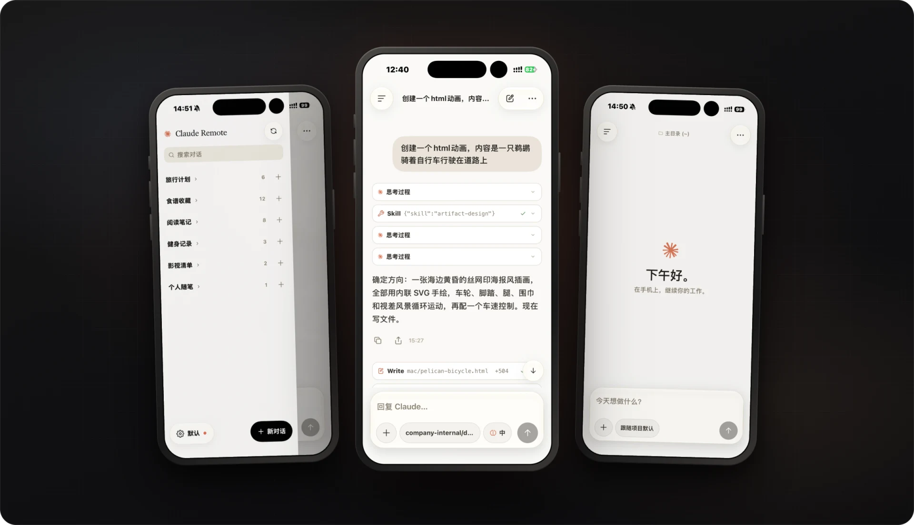

<div align="center">


# claude-remote

[English](README.md) · **简体中文**

### 在 iPhone 上远程查看、续聊与审批 Mac / Linux 主机上的 Claude Code 会话

**把桌面或服务器终端里的 Claude Code 带到手机上——实时镜像、双向接力、安全审批、多通道连接。**

Local-first · 只读 JSONL 历史 · Fail-closed 审批 · Tailscale / 自建 Relay

<br />

[](package.json)
[](#快速开始)

<br />

[快速开始](#快速开始) ·
[详细部署文档](docs/deployment.md) ·
[屏幕截图](docs/screenshots.md) ·
[整体结构](#整体结构) ·
[安全边界](#local-first-与安全边界) ·
[自建 Relay](deploy/relay/README.md) ·
[常用命令](#cr-控制台与常用命令) ·
[开发与目录](#开发与目录约定)

<br /><br />



<br />

**会话留在主机本地 · 审批永远由你掌控 · 直连与自建 Relay 自动切换**

</div>

> 浏览器客户端已移除。daemon 仅提供 API、WebSocket 和本机配对接口，根路径与网页静态资源返回 `404`。

---

## 为什么用 claude-remote？

<table>
<tr>

<td width="25%" valign="top">

### 实时镜像与续聊

直接读取主机 `~/.claude/projects/**/*.jsonl`。

手机端实时查看输出、选择模型与思考强度、上传图片/文件并续聊会话。

</td>

<td width="25%" valign="top">

### 终端与手机接力

手机与桌面/服务器共享同一份会话记录。

`cr open <id>` 可在终端用 `claude --resume` 接管；终端占用期间自动避免并发冲突。

</td>

<td width="25%" valign="top">

### Fail-closed 审批

工具调用与提问经手机端弹窗确认。

等待超时、审批取消或 daemon 重启会拒绝仍待处理的审批。

</td>

<td width="25%" valign="top">

### 多通道自动选路

支持局域网、Tailscale、自建公网 Relay 同时启用。

直连优先，断线自动重选；主机无需开放公网入站端口。

</td>

</tr>
</table>

---

## 整体结构

```text
iPhone App (app/ + web/core/)
   │  HTTP + WebSocket · Bearer Token
   ├── 直连通道：局域网 / Tailscale / mDNS（优先）
   └── 中转通道：https://<RELAY_HOST>/d/<deviceId> ── packages/relay（自建公网服务器）
                                                          ▲ 主机主动连出
主机 daemon (packages/daemon) ──── connector ─────────────┘
   ├── 读取 ~/.claude/projects/**/*.jsonl（只读）
   ├── 经 Agent SDK 驱动续聊（packages/agent-bridge）
   └── 审批状态机（packages/interactions，node:sqlite）
cr 命令行 (packages/cli)：全屏 TUI 控制台 · 启停 · 配对 · Relay 配置
```

---

## Local-first 与安全边界

| 项目 | 默认行为与约束 |
|---|---|
| 会话数据源 | 仅以主机 `~/.claude/projects/**/*.jsonl` 为准；daemon 只读不改写（写入仅来自 SDK resume 原生落盘） |
| 终端 / 手机互斥 | 实测 Claude Code 2.1.209：`--resume` 同 `session_id` 同文件追加；`--fork-session` 复制新文件。存活终端占用期间不抢占 |
| 审批策略 | 默认 300 秒超时拒绝；取消或重启也会拒绝待处理的审批 |
| 应用层鉴权 | 随机生成的固定 Bearer Token（`BRIDGE_TOKEN`），不自建加密协议 |
| 配对接口保护 | `/api/pair-info` 与 `/api/pair-qr.svg` 仅允许本机回环访问，经 Relay 或携带代理特征头一律返回 `403` |
| 公网中转边界 | 无官方托管云端；Relay 仅支持部署在你自己控制的 Linux 服务器上（HTTPS 在你的服务器上解包，请勿接入不可信 Relay） |

---

## 快速开始

<table>
<tr>

<td width="25%" valign="top">

### 01

**安装 `cr`**

`npm i -g @anyyu/claude-remote`

</td>

<td width="25%" valign="top">

### 02

**打通网络**

Tailscale Serve 或自建 Relay

</td>

<td width="25%" valign="top">

### 03

**安装 iPhone App**

下载 Release `.ipa` 自签安装

</td>

<td width="25%" valign="top">

### 04

**扫码配对**

运行 `cr pair` 开始使用

</td>

</tr>
</table>

### 一键交给 Agent 自动部署

复制下方提示词发给任意终端 AI Agent（如 Claude Code / Codex），Agent 会先确认部署在**本机**还是**远程服务器**，再自动完成环境检查、安装初始化与网络通道配置：

```markdown
请帮我部署并配对 claude-remote（项目仓库：https://github.com/xuzihan0823/claude-remote）。请严格按以下步骤执行，遇到需要我授权、登录或手工操作的步骤时停下来提示我：

1. 确认部署目标（先问我，不要默认假设）：
   - 询问我打算把 claude-remote 部署在「当前本机」，还是「远程服务器（macOS / Linux）」。
   - 如果选远程服务器：向我确认 SSH 连接方式（如 host 别名或 `user@host`）并验证连通性；后续第 2–4 步均在该目标主机上执行。

2. 环境检查（只读检查，不要擅自更改目标主机系统 Node）：
   - 确认目标主机系统为 macOS 或 Linux（`uname -s`，暂不支持原生 Windows）。
   - 检查 `node -v` 是否 >= 22.13.0；如果不满足，停下来告知我需要升级 Node.js。
   - 检查 `claude --version` 是否可用；如果找不到，停下来让我先在目标主机安装并登录 Claude Code CLI。

3. 安装与初始化目标主机：
   - 如果 `command -v cr` 不存在，运行 `npm install -g @anyyu/claude-remote` 安装（如果目标主机当前就在源码仓库目录且我明确要求从源码运行，再改用 `pnpm install && node packages/cli/bin/cr.mjs setup`）。
   - 运行 `cr setup` 生成 `BRIDGE_TOKEN` 并探测 `claude` 路径。
   - 若目标主机为 macOS，询问我是否希望开机自启并在后台常驻；如果我同意，执行 `cr config set autostart on`（否则保持默认随 `cr` 启停）。若目标主机为 Linux（无 `launchd`），提醒我在 `tmux`/`screen` 中保持 `cr` 运行，或使用 `cr up` 前台托管 daemon。

4. 询问我选择哪种手机连接方式，然后按对应分支配置（不要替我默认选择）：
   - 选项 A（Tailscale Serve，无需额外服务器）：先检查目标主机 `tailscale status`，未连接时让我先在目标主机和 iPhone 登录同一个 Tailscale 网络；确认 daemon 运行后（macOS 自启模式确保 `cr up` 成功；随 `cr` 运行模式提醒我保持 `cr` 运行并在另一个终端操作），执行 `cr pair --tailscale`。若提示需要浏览器授权开启 HTTPS Serve，停下来让我点链接授权后再继续。
   - 选项 B（仅同一 Wi-Fi 局域网直连，主要适用于本机）：执行 `cr config set host 0.0.0.0`，按提示重启或重开 daemon 后运行 `cr pair`。
   - 选项 C（自建公网 Relay）：指导我（或经我授权后通过 SSH）在公网 Linux 服务器运行 `curl -fsSL https://raw.githubusercontent.com/xuzihan0823/claude-remote/main/deploy/relay/install.sh | sudo bash`（并放行安全组 443/80 端口），取得输出的那条 `cr relay add <地址> <密钥>` 在目标主机上执行，再运行 `cr pair`。
```

<div align="center">

### [查看手动步骤与详细部署文档 →](docs/deployment.md)

**支持 macOS / Linux（含服务器）· Node.js ≥ 22.13.0 · Claude Code CLI · iPhone（[下载 Release `.ipa`](https://github.com/xuzihan0823/claude-remote/releases/latest) 自签安装）**

</div>

---

## `cr` 控制台与常用命令

直接运行 `cr` 会进入全屏 TUI 控制台（支持会话列表、搜索、详情回看、实时输出、审批、配对二维码与日志查看；进入后按 `?` 查看全部快捷键）。子命令适合脚本或快速操作：

| 命令 | 用途 |
|---|---|
| `cr` | 进入全屏控制台（首次运行自动初始化） |
| `cr setup` | 重新探测 `claude` 路径并检查初始化状态 |
| `cr pair [--tailscale]` | 打印配对二维码与候选地址；加 `--tailscale` 自动配置 Tailscale Serve |
| `cr status` | 查看 daemon、launchd、通道（Tailscale / Relay）与会话状态 |
| `cr up` / `cr down` / `cr restart` | 启动 / 停止 / 重启 daemon |
| `cr config` | 查看或修改配置（`host`、`port`、`bark`、`ntfy`、`autostart` 等） |
| `cr relay add \| status \| on \| off \| remove` | 管理自建 Relay 连接 |
| `cr ls [-n 20]` / `cr search <词> [--full]` | 列出或搜索最近会话（`--full` 全文检索） |
| `cr show <id>` / `cr open <id>` | 查看会话最近消息 / 在终端 `claude --resume` 接管 |
| `cr logs` | 实时查看 daemon 日志 |

---

## 开发与目录约定

<details>
<summary><strong>展开查看源码运行、构建与测试命令</strong></summary>

<br />

### 从源码运行主机端（macOS / Linux）

```sh
git clone https://github.com/xuzihan0823/claude-remote.git
cd claude-remote
pnpm install
node packages/cli/bin/cr.mjs setup
```

- 源码模式（`repo`）配置位于仓库根目录 `.env`（可参考 [.env.example](.env.example)），`cr setup` 会在 `~/.local/bin/cr` 创建软链；npm 全局安装模式（`package`）配置位于 `~/.claude-remote/config.env`。
- 开发时 daemon 通过 `tsx` 运行（`pnpm dev`）；`pnpm build:npm` 会构建发布到 `dist/npm/` 的 CLI 与 daemon 产物。
- 手机端 `app/` 维护独立的 `npm` 依赖与原生工程，不纳入根 `pnpm` workspace。

### 开发检查

```sh
pnpm typecheck   # 检查工作区 TypeScript
pnpm test        # 运行核心逻辑、手机端辅助逻辑与各包测试（统一使用 node:test / tsx --test）
pnpm build:npm   # 构建 npm 发布包
```

> 兼容命令 `pnpm test:web` 仅运行 `web/core/` 测试，不代表仍存在浏览器界面；`web/core/` 暂时保留原路径以避免大范围改写手机端 import。

</details>

### 仓库目录

```text
claude-remote/
├── README.md            英文首页
├── README.zh-CN.md      中文首页、Agent 快速部署和命令说明
├── app/                 React Native + Expo 手机端（独立 npm 依赖；iOS 原生工程生成到 app/ios/）
├── docs/                详细部署文档、屏幕截图与架构说明
├── packages/            daemon、agent-bridge、interactions、cli、relay
├── web/core/            手机端共用的连接、缓存、模型与流草稿逻辑及测试
├── web/vendor/          手机端依赖的 Markdown 解析器与事件 hook 兼容依赖
├── deploy/relay/        公网 Relay 一键安装与 Docker/Caddy/systemd 部署文件
└── scripts/             npm 打包、launchd 入口与历史会话修复脚本
```

---

## 开源许可

项目原创代码采用 [MIT](LICENSE)。随仓库分发的第三方代码保留原许可，详见 [web/vendor](web/vendor/README.md) 和 [iOS 第三方许可](app/THIRD-PARTY-NOTICES.txt)。Claude Agent SDK 由 npm 单独安装，适用 [Anthropic 条款](https://code.claude.com/docs/en/legal-and-compliance)。

## Friends

[Linux.Do](https://linux.do/) — A new ideal community
