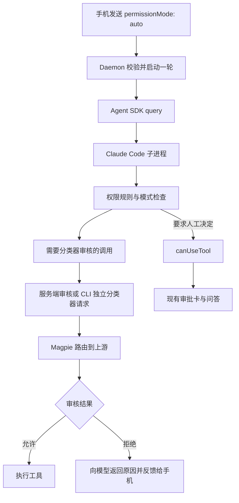

# Claude Code Auto Mode 适配规划

## 目标与范围

为新建会话、续聊和默认权限设置增加原生 `auto` 模式，让 Claude Code 的分类器审核工具调用，减少手机上的常规审批；仍需用户决定的操作继续通过现有审批卡处理。

本规划基于仓库 `46227b6` 和本次本机 Magpie 实测。本文仅提出实施方案，功能尚未实现。实现应覆盖权限模式传递、实际模式同步、自动拒绝反馈和断线恢复，不另建模型审核服务，不修改 Magpie，不自动修改用户的 Claude 设置、模型映射或凭据，也不增加本轮运行中即时切换模式的能力。

## 已确认的事实与验证边界

| 项目 | 证据与结论 |
| --- | --- |
| SDK 接口 | 仓库锁定 `@anthropic-ai/claude-agent-sdk@0.3.212`，其 `PermissionMode` 已包含 `auto`，无需为了新增该枚举而升级 SDK |
| 项目限制 | 前端模式列表、服务端白名单、Runner 和 Bridge 参数类型均未包含 `auto`；当前 API 会返回 `invalid_permission_mode` |
| CLI 版本 | 本次真实调用使用本机 Claude Code `2.1.309`；SDK 包声明自带 Claude Code `2.1.212`，两者不能混为一谈 |
| Magpie 入口 | 已通过监听进程与模型目录确认 CLI 配置指向 Magpie 本地 HTTP 网关 |
| CLI 实测 | 保留原有模型与审核配置，只显式选择 `auto`；SDK 初始化帧报告 `permissionMode: auto`，分类器审核成功，临时目录中的 Python 写文件命令执行成功 |
| 服务端审核 | 首轮日志出现 `server_no_result`，随后 CLI 自动停止该会话的服务端审核尝试，改为自行发起分类器请求；此次未返回审核结果不代表 Magpie 所有版本都不支持该协议 |
| SDK 实测 | 使用项目锁定的 SDK，指定本机 CLI，仅在测试子进程设置 `CLAUDE_CODE_AUTO_MODE_SERVER=0`；审核成功、文件创建成功，`canUseTool` 调用次数为 0 |
| 模型选择 | 两次日志均显示主模型和分类器请求使用相同的 Magpie DeepSeek 路由 ID；配置中 Sonnet 别名映射到该 ID，未设置 `CLAUDE_CODE_AUTO_MODE_MODEL` |
| 耗时与费用 | 两次分类器请求约 2.4 秒和 1.7 秒；两轮运行报告费用合计约 0.059 美元，实际账单以网关和上游为准 |

实测在临时目录进行，禁用了插件等自定义行为，没有经过项目 HTTP/WS、手机界面或项目的流式输入与恢复会话链路。已验证的是原生分类器能够通过当前 Magpie 路由返回可解析的批准结果；未验证危险操作的拒绝效果、提示注入抵抗能力、所有模型/渠道的兼容性或旧 CLI 的完整行为。不能据此宣称非 Claude 模型具有与官方分类器相同的安全能力。

公开文档、测试和 PR 不记录真实网关地址、渠道路由 ID、凭据、个人路径或原始调试日志。示例统一使用 `<CLAUDE_BIN>`、`<CLASSIFIER_MODEL_ID>` 等占位符。原始实测日志保留在会话临时目录，不提交。

## 底层机制与接入决策



SDK 将 `permissionMode` 转为子进程参数 `--permission-mode auto`；`canUseTool` 通过标准输入输出控制协议接收尚需人工决定的请求。分类器已经批准或直接拒绝的调用不会必然进入该回调，不能在回调里补写一个“永远 allow”的实现来冒充 auto。

分类器模型由 Claude Code 根据有效配置、别名映射和服务端策略选择；Magpie 根据请求中的模型 ID 路由。`ANTHROPIC_DEFAULT_SONNET_MODEL` 能影响默认分类器，较新 CLI 的 `CLAUDE_CODE_AUTO_MODE_MODEL` 可指定独立审核模型，但可能被 CLI 忽略或受模型策略限制。主模型与分类器模型不保证相同，界面不能从主模型推测审核模型。当前 SDK 没有已确认可用于稳定展示分类器模型的事件，本期不新增该展示，也不解析调试日志作为产品接口。

### Magpie 配置策略

首版保持 Claude Code 原生行为，不凭本地地址、模型名称或 `/v1/models` 推断服务端审核能力，不自动注入审核模型或强制关闭服务端审核。原配置已实测可以自动回退，因此不需要新增网关识别模块或兼容性探测端点。

若管理员明确选择独立分类器请求，可在 Daemon 的本地配置文件中设置以下环境变量，重启后生效：

```dotenv
CLAUDE_BIN=<CLAUDE_BIN>
CLAUDE_CODE_AUTO_MODE_SERVER=0
# 可选；先确认该 ID 可调用且被 CLI 接受
# CLAUDE_CODE_AUTO_MODE_MODEL=<CLASSIFIER_MODEL_ID>
```

这些变量已经能通过 Daemon 环境传入子进程，不新增专用 HTTP 参数或手机端凭据设置。配置影响范围按 Claude Code 自身语义执行，可能影响规划模式等也会使用分类器的场景，不能描述为仅对 `auto` 有效。需要更小影响范围时，用独立 Daemon 启动环境验证，不改写全局 `~/.claude/settings.json`。

`CLAUDE_CODE_AUTO_MODE_SERVER=0` 只关闭服务端审核路径，CLI 仍通过 Magpie 请求上游模型；不表示离线推理或本机运行模型。独立审核可能增加请求数、延迟和费用。

### 可执行文件与版本

复用现有 `CLAUDE_BIN` 配置，部署时明确选择已验证的本机 CLI。当前版本探测走 `CLAUDE_BIN || PATH claude`，Bridge 未设置 `CLAUDE_BIN` 时却可能用 SDK 自带程序；实现必须统一运行与探测的可执行文件解析，或在无法确认时如实报告未知，不能把 PATH 版本当作实际运行版本。

不把 `2.1.309` 写成所有 auto 调用的最低版本：它只是本次验证版本。指定独立分类器模型的环境变量要求 `2.1.302+`，关闭服务端审核的变量也有版本要求，应按官方文档和实际程序确认。旧程序不支持时给出明确错误或实际降级状态，不自动改为 Bypass，不自动安装/更新 CLI。

## 当前代码与修改位置

| 位置 | 拟修改内容 |
| --- | --- |
| `web/core/modes.js` | 模式集合增加 `auto`；保持原有存储键；旧值与非法值处理保持兼容 |
| `app/src/components/composer/ModeSheet.js`、`ModePill.js`、`app/src/screens/settings/labels.js` | 增加“自动审核”名称和“由模型审核操作，必要时仍需确认”的说明；补齐所有使用模式名称的入口 |
| `app/src/screens/settings/PermissionModeScreen.js` | 默认模式设置可选择 auto；保留 Bypass 原有确认逻辑 |
| `app/src/lib/create-session.js`、`ChatComposer.js`、`NewChatComposer.js` | 验证新建、续聊、重试传递 auto；保留 `clientMessageId` 去重与原请求身份 |
| `packages/daemon/src/server.ts` | 新建/续聊权限白名单增加 auto，增加实际模式与拒绝/提示事件的 WS 映射及状态快照字段 |
| `packages/daemon/src/run/runner.ts` | 参数类型增加 auto；缓存本轮请求模式和 SDK 报告模式，向外转发带 runId 的状态与诊断 |
| `packages/agent-bridge/src/sdk-bridge.ts` | 接受 auto 并透传；使用 SDK 的权限类型约束，去掉目前限制为四种模式的重复断言；保留项目对外白名单 |
| `packages/agent-bridge/src/types.ts`、`event-adapter.ts` | 适配 init/status 中的权限模式、permission_denied 与面向用户的必要提示 |
| `app/src/screens/ChatScreen.js`、现有工具结果展示与状态处理 | 展示实际生效模式，避免旧 run 覆盖新 run；在已有工具记录中展示拒绝原因，避免重复卡片 |
| `packages/daemon/src/index.ts` 与可执行文件解析调用方 | 确保版本探测对应实际运行的 CLI；不顺带重构启动管理 |
| `docs/architecture.md` | 更新 API 接受值、实际模式与回退的 WS 契约、快照字段和可选兼容配置说明 |

实施时从最新 main 再核对调用方和工作树，尤其避免覆盖文件预览等并行任务。此表是影响范围，不要求为了“统一”而重构无关模块。

## 请求模式、实际模式与断线恢复

当前 `run.started.permissionMode` 是调用者请求值，不能当作 SDK 确认值。首版保留该字段的现有含义，新增独立状态事件。客户端保存的下一轮选择与本轮实际模式分开处理，避免模型降级或用户在本轮期间修改下一轮选择时互相覆盖。

### 建议协议

HTTP 请求不增加字段：

```json
{ "text": "完成这项修改", "permissionMode": "auto" }
```

接受的外部值为 `default | acceptEdits | plan | auto | bypassPermissions`，不顺便开放 `dontAsk`。省略模式仍按当前约定使用 `default`，不把“省略”改成继承用户 auto 默认。

新增实际模式事件示例：

```json
{
  "type": "permission-mode",
  "sessionId": "<session-id>",
  "runId": "<run-id>",
  "requestedMode": "auto",
  "effectiveMode": "default",
  "source": "sdk"
}
```

- `system/init.permissionMode` 建立实际模式；`system/status.permissionMode` 更新它。未知模式不伪造成 default，也不能使旧客户端崩溃。
- SDK 尚未确认时，显示“自动审核，正在确认”，不提前标记已生效。
- 如果 SDK 回报 default，则明确显示“本轮已转为标准审批”。未提供原因时只说明“CLI 未启用或已退出自动审核”，不能猜测是余额、模型或组织策略导致。
- `session-state` 活跃快照增加可选 `requestedPermissionMode`、`effectivePermissionMode`，沿用 `activeRunId`。订阅时先发快照，保证重连无需重新启动推理就能恢复显示；无活跃运行时这些字段缺省。
- 所有更新按 sessionId/runId 检查；旧轮次的 init、status、拒绝或终态不得影响新轮次。下一轮选择保持用户意图，SDK 的临时降级不自动回写全局默认或修改已提交的请求重试参数。
- 终端接管后的即时模式不在本期观测范围；Daemon 没有对应 SDK 连接时不宣称了解终端当前权限模式。

## 自动拒绝、人工审批与提示

### 自动拒绝

适配 SDK 的 `system/permission_denied`，至少保留 `tool_use_id`、`tool_name`、可选 `agent_id`、`decision_reason_type`、`decision_reason` 和 `message`，并携带 sessionId/runId 与稳定事件 ID。优先附加到已有工具结果，按工具调用 ID 和事件 ID 去重，不伪造一个可直接点“同意”的待审批任务。

当随后的 `tool_result` 也带错误时合并展示。子代理拒绝不能错误附到主代理同名工具上，未知原因显示 CLI 返回的消息。一项工具被拒绝不直接等于整轮失败，仍按 SDK 的 result/异常结束一轮。

断线恢复复用正式消息中的工具错误作为基础；如结构化原因未写入转录，只缓存活跃 run 中的拒绝信息并随重连补发，限制数量，不建立额外长期数据库。实现时先核对 SDK 实际转录行为，再确定是否需要该内存补发。

### 人工审批与提问

保持 `createPermissionAdapter` 的确认后允许、超时/断线未确认则拒绝的语义。明确的 ask 规则、`AskUserQuestion` 及 CLI 决定升级给宿主的请求继续显示现有卡片。

分类器拒绝不保证转为回调，不能承诺所有被拒绝操作都能在手机上一次点击重试。用户可以补充明确授权，或选择标准模式后在下一轮重试；首版不调用未经验证的“强制覆盖分类器”接口。

### 用户可见提示

本次 Claude Code 发出了独立审核仍可能计费的 `system/informational` 提示，现有适配器会丢弃它。首版只转发 SDK 明确面向用户的 informational/warning 消息，排除 thinking token 等内部事件和调试日志。按事件 ID 去重，必要时折叠为会话提示，不在每个工具旁重复展示。提示中可能有本地地址，保留在已鉴权会话内，不写入公开文档或公共日志。

## 实施顺序

1. **打通参数与执行环境**：增加 auto 的类型与白名单；确认实际 CLI 路径、版本和配置继承；不更改默认模式、不改审核模型映射。
2. **补齐服务端事实反馈**：适配 SDK 模式、拒绝和必要提示；缓存实际模式并加入活跃快照；处理 run 身份与去重。
3. **完成手机入口与状态展示**：菜单/默认设置加入自动审核；区分下一轮选择和本轮实际状态；复用工具结果展示拒绝，保留人工审批流程。
4. **完成相关回归与 Magpie 端到端验收**：验证流式输入、新建/恢复会话、HTTP/WS 与手机端，更新架构说明。实施任务独立开分支和草稿 PR，不把原始日志或本机配置提交。

## 验证与验收

### 自动化回归

优先扩展现有测试，断言外部行为而非仅比较枚举：

| 场景 | 预期与验证位置 |
| --- | --- |
| 新建/续聊发送 auto | HTTP 接受并将 auto 送达模拟 SDK，非法值仍返回 400；Bridge 不把它重置为 default |
| 省略模式与其他模式 | 保持 default 以及原有四种模式行为，不影响 Bypass 确认 |
| SDK init/status | 请求 auto、实际 default 能广播正确状态；缺失或未知值不伪造确认；旧 run 更新被忽略 |
| 断线重连 | 模式快照先于后续事件，保留当前 activeRunId 和实际模式；无活跃运行不遗留“auto 已生效” |
| 自动批准 | 主路径不额外创建审批任务；应用不重做分类器判断 |
| 自动拒绝 | 结构化拒绝与工具错误只显示一项，原因正确；子代理身份保留；整轮仍可继续 |
| ask 与问答 | 现有审批/答题卡继续可用，超时拒绝和取消仍有效 |
| 用户选择与重试 | 本轮降级不覆盖下一轮选择；失败重试仍使用原 clientMessageId、正文和权限参数 |
| 环境与 CLI | 显式 env 覆盖保留；宿主鉴权清理保持现状；版本探测与运行程序一致 |

运行对应 package 与 mobile/web 测试及类型检查；全套检查是否必须以仓库现行流程为准，不因本文而添加与本功能无关的测试。

### 真实 Magpie 验收

只在隔离临时目录内使用少量模型调用，设置轮数/费用/时间上限；不执行真实破坏性命令、不向外部发送测试数据。

1. 保留用户模型映射，通过项目完整 HTTP/WS 链路新建 auto 会话；确认实际模式和文件落盘。
2. 对该会话续聊，覆盖项目当前每轮 query、流式输入、resume 与落盘方式；确认 auto 继续有效。
3. 核对分类器日志的模型、请求完成及工具结果，分别验证原生服务端回退和显式 `CLAUDE_CODE_AUTO_MODE_SERVER=0`；记录实际版本，日志不提交。
4. 用精确的临时文件命令匹配 ask 规则，确认手机能批准/拒绝；用无害命令匹配 deny 规则，确认规则阻止执行。deny 规则通过不代表分类器危险识别通过。
5. 分类器拒绝和异常分支用模拟 SDK/本地响应夹具覆盖；如确需真实分类器拒绝实验，另设计无法造成副作用的受控用例，不能拿真实删除、部署或外传来试探。
6. 审核期间断线重连、停止运行，确认模式、审批和终态不会串到新 run。没有有效审核结果时不得自动允许。

### 完成标准

- 新建、续聊、默认设置均可选择 auto，实际调用达到原生 SDK。
- 手机显示 SDK 确认的真实模式，降级与重连状态正确。
- 自动拒绝可解释，人工审批仍可用，停止/超时不产生默认放行。
- Magpie 实测链路与上述自动化回归通过；无法验证的模型/版本明确保留未知。
- 架构文档与实际协议一致，未提交本机敏感配置、日志或模型渠道信息。

## 回退与后续范围

遇到兼容问题时，用户将下一轮改为标准或自动编辑；撤销可选环境覆盖并重启 Daemon。已启动轮次通过现有停止功能终止后再发新轮次，不把正在审核的操作切到 Bypass。

本期不增加自动模型替换、分类器模型选择器、Magpie 特征识别、预先付费探测、拒绝历史管理、永久诊断存储或自建审核模型。后续若需要展示分类器模型、支持运行中切换或更换 SDK/CLI，另按稳定接口与实测证据设计。

## 官方参考

以下规则随 Claude Code 版本变化；实现以实际 CLI/SDK 行为为准，不能把当前官方所有新能力归给仓库自带的旧 CLI。

- [权限模式、分类器与可用条件](https://code.claude.com/docs/en/permission-modes)
- [分类器模型选择](https://code.claude.com/docs/en/permission-modes#default-classifier-model)
- [服务端审核与回退](https://code.claude.com/docs/en/permission-modes#server-side-classifier-review)
- [Agent SDK 权限与回调](https://code.claude.com/docs/en/agent-sdk/permissions)
- [Auto 配置与规则](https://code.claude.com/docs/en/auto-mode-config)
- [环境变量](https://code.claude.com/docs/en/env-vars)
