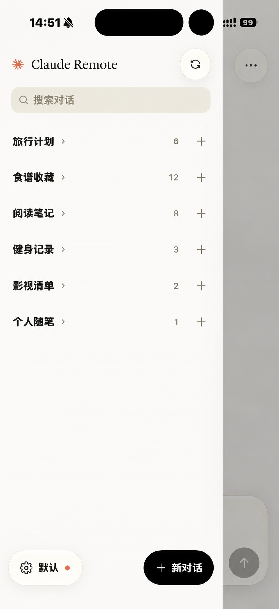
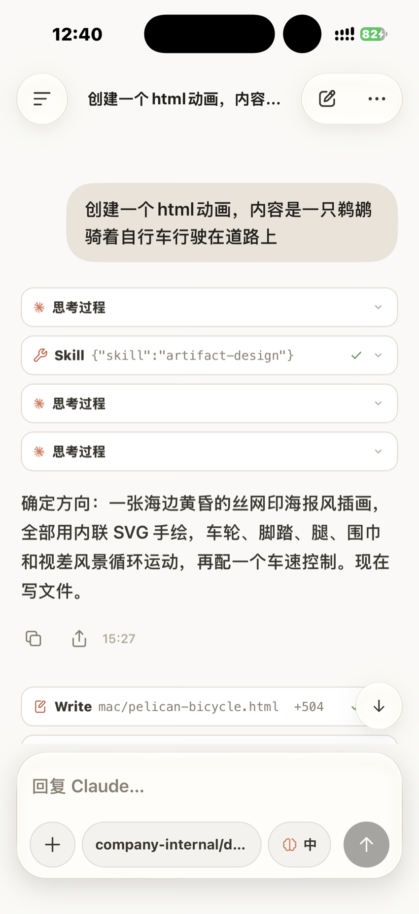
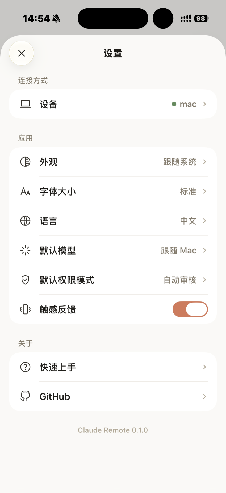

# 屏幕截图

iPhone 客户端主要界面预览，会话与 Mac / Linux 主机端的 Claude Code 实时同步。

<table>
<tr>

<td width="50%" align="center" valign="top">

主页与快速新建对话，支持选择模型与附件

</td>

<td width="50%" align="center" valign="top">

按项目目录分组的会话列表与搜索

</td>

</tr>
<tr>

<td width="50%" align="center" valign="top">

实时流式输出、思考过程与工具调用卡片

</td>

<td width="50%" align="center" valign="top">

设备管理、外观、默认模型与权限模式设置

</td>

</tr>
</table>

[← 返回 README](../README.zh-CN.md) · [详细部署文档](deployment.md)
