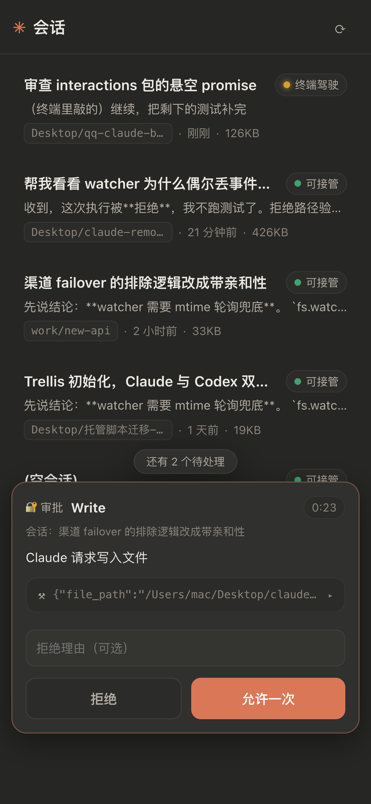
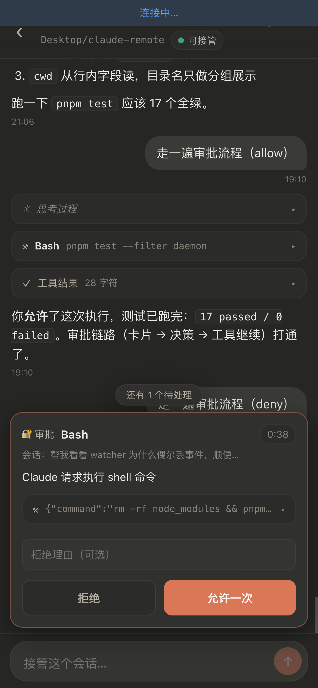
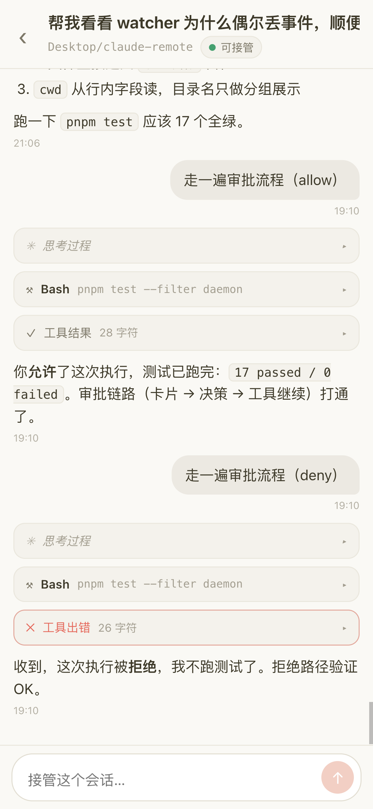
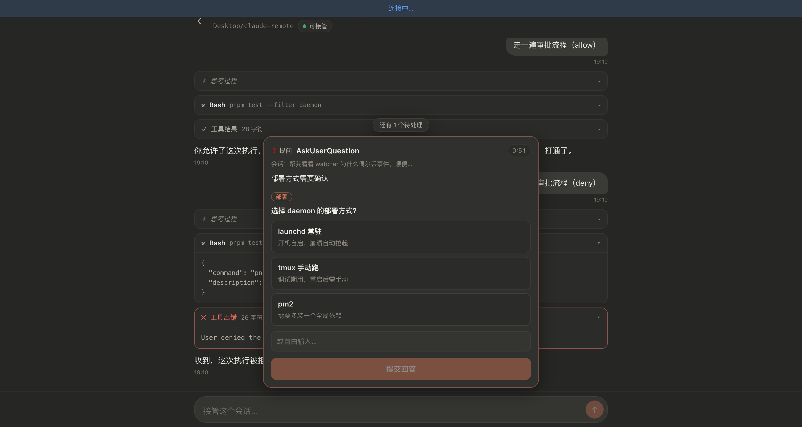

# 05 · Web UI 结果报告

> 任务卡：`task/05-web.md` · 完成日期 2026-07-18 · 全程对 mock 自测，未依赖 daemon

## 做了什么

`web/` 全套，纯静态免构建，`node web/mock/mock-server.mjs` 即可完整跑通验收流程：

```
web/
├── index.html               入口（viewport/safe-area/PWA meta）
├── app.js                   全部前端逻辑（Preact+htm，约 700 行，单文件）
├── style.css                暖色暗色主题（跟随系统，亮色也做了）
├── manifest.webmanifest     PWA（standalone、图标、主题色）
├── icons/                   占位图标（starburst；PNG 由脚本生成 + SVG）
├── vendor/                  三件套（见下）
└── mock/
    ├── mock-server.mjs      契约假后端（零依赖，含手写 WS server）
    └── make-icons.mjs       图标生成器（零依赖 PNG 编码器）
```

已实现（对应卡面任务明细 1–7 全部）：

- **列表页**：lastActiveAt 排序、title/cwd 尾段/相对时间/大小、三色状态徽标；30s 定时刷新 + 手动刷新 + `visibilitychange` 刷新 + WS status 实时改徽标。
- **聊天页**：user 右气泡（纯文本）/assistant 全宽 markdown；`tool_use`（工具名+input 摘要，`<details>` 展开完整 JSON）、`tool_result`（默认折叠，isError 红框红标）、`thinking`（默认折叠斜体）、`meta`（灰字一行 rawType）；首屏尾部 100 条，滚动到顶自动 `beforeSeq` 翻页且**滚动位置保持**；WS 实时追加，`seq:blockIndex` Map 去重；run 事件显示 typing 动画 + 运行条；贴底自动滚动，离底显示「↓」跳底按钮。
- **发送**：仅 idle 可发；非 idle 置灰并显示原因（终端驾驶中/运行中）；POST 202 后显示「发送中」pending 气泡，WS 回显同文本后移除；**409 时 toast 提示 + 按响应刷新状态 + 草稿保留**。
- **审批卡**：页内卡片（非 alert），一次展示最早一张 + 「还有 N 个待处理」排队计数；approval 卡 = 工具名 + input JSON 折叠 + 拒绝理由（可选）+ 允许一次/拒绝；question 卡 = 选项按钮（multiSelect 切换多选 + 全部作答才可提交）+ 每题自由输入兜底；expiresAt 每秒倒计时（≤20s 变红）；`approval.resolved` 后落章（已允许/已拒绝/已作答/已超时）1.8s 后消失；409/404 时提示并移卡。
- **连接层**：token 存 `localStorage`，首访页内弹窗输入并用 `GET /api/health` 校验，401 自动清 token 重新弹窗；WS 指数退避重连（1s→2s→…→30s + 抖动，CONNECTING 悬挂 6s 守卫），顶部状态条（连接中/已断开 Xs 后重连·点击立即重试）；重连后重发 subscribe + 拉尾部消息补缺口（无重叠则继续向前最多 3 页直到接上，seq 去重）+ 刷新会话状态。
- **移动端/PWA**：`viewport-fit=cover` + `env(safe-area-inset-*)`；`visualViewport` 高度写入 `--vvh` 保证键盘弹出时输入框可见且消息贴底；manifest + 192/512/180 图标，iOS 加主屏 meta 齐全。
- **mock server**：契约全端点（Bearer 鉴权、401/404/400/409 语义、分页）+ 手写零依赖 WS server（RFC6455 握手/掩码/ping-pong/close）+ 模拟器：每 20s 给 terminal-driving 会话推实时消息、每 30s 推一张审批（Bash/Write/单选/多选轮换，90s TTL 自动 expired）、每 45s 翻转一个会话状态、发送触发模拟 run（echo → thinking → 回复），消息带「审批」触发 run 中审批（allow → tool_result 成功；deny → isError）。`POST /__mock/drop-ws` 强断所有连接测重连（mock 专属，契约之外）。

## Vendor 清单

| 文件 | 来源 | 版本 | 大小 |
|---|---|---|---|
| `vendor/preact-htm-standalone.module.js` | unpkg `htm/preact/standalone.module.js` | htm 3.1.1（内置 preact 10.x，构建于 ^10.2） | 13KB |
| `vendor/marked.esm.min.js` | jsDelivr `marked@18.0.6/lib/marked.esm.min.js`（Terser 自动压缩） | marked 18.0.6 | 42KB |

**偏离卡面**：卡面写 `marked.min.js`，但 marked ≥12 的 npm 包已不再发布压缩版 UMD（只有 `lib/marked.esm.js` / `lib/marked.umd.js`），故取 jsDelivr 的压缩 ESM 直接 `import { marked }`，更贴合原生 ES modules 底座。三件套之外**零新增依赖**（mock 的 WS server 手写，图标生成用 node 内置 zlib）。

## 界面截图

| | |
|---|---|
|  |  |
| iPhone 视口 · 列表 + Write 审批卡 + 排队计数 | iPhone 视口 · 聊天 + Bash 审批卡（run 中触发） |
|  |  |
| iPhone 视口 · 亮色模式（跟随系统） | 桌面宽度 · question 卡 + tool_use JSON/错误结果展开 |

另有桌面亮色两张：`desktop-list-approvals.png`、`desktop-chat.png`。

## 自测结果（Chrome + iPhone 390×844 视口模拟）

验收清单全过，控制台零报错：

1. 列表 → 排序/徽标/预览正确，45s 状态翻转实时改徽标 ✅
2. 聊天渲染 → 28 user / 37 assistant / 14 thinking / 9 tool_use / 9 tool_result（3 错）/ 3 meta / 代码块+表格全部正确 ✅
3. 翻页 → 每页 100 条向上翻 4 页到头，滚动位置保持，同 seq 块组不被切开 ✅
4. 发送 → pending 气泡 → WS 回显替换（无重复）→ typing → 回复 → 徽标「运行中→可接管」→ 输入恢复 ✅
5. 409 → 断 WS 后台抢跑 run 制造过期状态 → UI 发送被 409 → toast「Claude 正在运行，发送被拒」+ 状态纠正 + 草稿保留 ✅
6. 审批 → 允许（tool_result 成功）/ 拒绝（isError）/ 单选提交 / 多选提交 / 90s 超时 expired 落章消失 / 排队推进，全通 ✅
7. 断线重连 → drop-ws 后横幅倒计时 → 自动重连 → 补缺口拿回断线期间消息、恰好一条不重复 ✅

## 对契约的疑问 / 建议（06 集成对表用）

1. **缺单会话元信息端点**：聊天页深链进入时拿 title/cwd/status 只能拉整个 `GET /api/sessions` 找（我拉 limit=200 兜底）。建议加 `GET /api/sessions/:id` 或在 messages 响应里带会话元信息。
2. **审批不可拉取，刷新即丢**：approval 只有 WS 推送，页面刷新/重连后 pending 中的卡拿不回来（等下一张或超时）。建议加 `GET /api/interactions?pending=1`，或 subscribe 后由 daemon 重放未决审批。
3. **messages 分页的 limit 语义**：多 block 共享同 seq 时，若按条数硬切可能把同 seq 组切到两页，`beforeSeq=firstSeq` 会漏掉残块。mock 的实现是**向前扩展到组边界**（宁多勿漏），建议 daemon 同规则并写进契约。
4. **`approval.resolved` 无 sessionId**：无法按会话过滤，mock 广播给所有连接、前端按 interactionId 匹配。无碍，但契约可注明「广播语义」。
5. **重连补缺口只能倒着翻**：没有 `afterSeq` 参数，断线久了要多翻几页找重叠（前端限 3 页，极端情况可能有洞）。阶段一够用，列为已知限制。

## 遗留问题 / 已知 UI 债

- **无下拉刷新手势**：iOS 原生 overscroll 与自定义手势冲突，按卡面「或」的选项用了定时+手动+WS 实时（体验上足够）。
- 审批卡一次只展示一张（其余排队计数），密集审批时需逐张处理；真实场景审批频率远低于 mock 的 30s 一张，可接受。
- thinking/tool 详情超长时容器内滚动（max-height 320px），无语法高亮（不引额外 vendor）。
- 长会话无虚拟滚动，430+ 消息节点实测流畅；万条级会话首屏只加载尾部 100 条，翻页才增长，风险可控。
- 真机未测项：iOS Safari 键盘遮挡的 `visualViewport` 方案、safe-area、Tailscale 网络下的 wss——留给 06 的 M5 真机验收。
- 本机 8787 被一个既有 python 进程占用（PID 1253），mock 默认端口冲突时会提示改用 `BRIDGE_PORT=8788`；**06 部署 daemon 时注意端口**。

## 给 06 集成的注意事项

- 前端对后端的全部假设都来自 `docs/api-contract.md`，daemon 换上后应零改动直连；若 daemon 端点行为与上面 5 条疑问的处理不一致，先对表。
- token 校验入口用的是 `GET /api/health`（401 即弹 token 窗），daemon 需保证 health 也走鉴权（契约「失败一律 401」的理解）。
- 静态托管：daemon 托管 `web/` 时直接整目录即可，无构建产物；`/__mock/*` 是 mock 专属，daemon 不需要实现。
- 验证命令：`BRIDGE_PORT=8788 node web/mock/mock-server.mjs` → 浏览器 `http://127.0.0.1:8788`（token：`mock-token`）。
